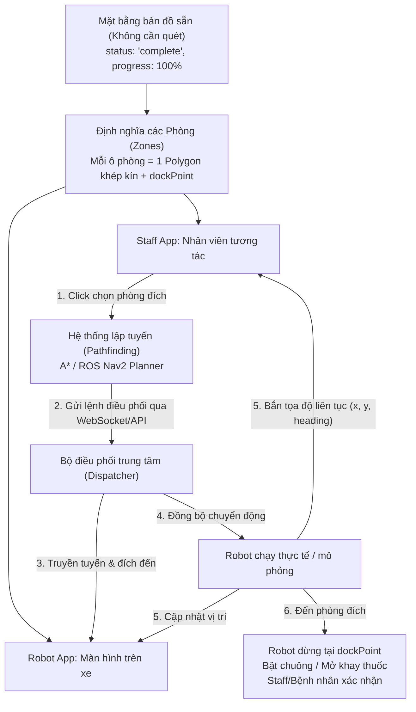

# TÀI LIỆU LUỒNG NGHIỆP VỤ BẢN ĐỒ & ĐIỀU PHỐI ROBOT (STAFF APP - ROBOT INTERFACE)

> **Dự án:** MediAssist Rover (FE_WEB_MAR)  
> **Mục đích:** Tài liệu hóa toàn bộ luồng nghiệp vụ, cấu trúc file source code và kiến trúc tích hợp giữa bản đồ bệnh viện, ứng dụng cho nhân viên (Staff App) và giao diện trên thân robot (Robot App).

---

## 1. TỔNG QUAN HỆ THỐNG & MỤC TIÊU NGHIỆP VỤ

Hệ thống phục vụ bài toán **vận chuyển y tế tự hành (AMR) trong bệnh viện**:
- **Staff App (Dành cho y bác sĩ / nhân viên):** Trực quan hóa mặt bằng bệnh viện. Mỗi phòng bệnh là một ô vùng (**Zone**). Nhân viên có thể chọn phòng trên sơ đồ $\rightarrow$ bấm lệnh điều phối $\rightarrow$ hệ thống hiển thị đường đi (Path) và biểu diễn Robot là một **hình vuông nhỏ** di chuyển theo thời gian thực tới phòng.
- **Robot Interface (Màn hình cảm ứng trên robot):** Đồng bộ cùng hệ tọa độ với Staff App, hiển thị vị trí hiện tại của robot trên bản đồ, điểm đến tiếp theo, trạng thái dẫn đường và nút bấm tương tác nhận/trả thuốc tại phòng bệnh.
- **Bản đồ không cần quét:** Thay vì bắt buộc robot phải lái thủ công để quét SLAM từng mét, hệ thống hỗ trợ nạp cấu hình mặt bằng có sẵn hoặc ảnh floorplan, mở khóa ngay tính năng điều phối phòng và điểm đến.

---

## 2. CẤU TRÚC FILE & VAI TRÒ TRONG SOURCE CODE

Toàn bộ logic bản đồ hiện tại nằm trong thư mục: `FE_WEB_MAR/src/pages/Admin` và `FE_WEB_MAR/src/pages/Workstations`.

```
FE_WEB_MAR/src/
├── pages/
│   ├── Admin/
│   │   ├── lidarGeometry.js          <-- [HÌNH HỌC GỐC] Tọa độ tường, sàn, kích thước map chuẩn 1200x680
│   │   ├── LidarMap.jsx              <-- [RENDERER] Component SVG + Canvas vẽ bản đồ, vùng, điểm và robot
│   │   ├── MapStudioFigma.jsx        <-- [STUDIO GỐC] Màn hình quản lý 3 bước: Quét -> Vẽ Vùng -> Điểm đích
│   │   ├── mapStudioModel.js         <-- [STATE/DATA] Model dữ liệu nháp (draft), validation và localStorage
│   │   ├── mapFeatureDrag.js         <-- [TƯƠNG TÁC] Logic kéo thả đỉnh đa giác và điểm trên SVG
│   │   ├── MapFeatureProperties.jsx  <-- [FORM] Form cấu hình thuộc tính của Vùng và Điểm đích
│   │   └── zoneCatalog.js            <-- [DANH MỤC] Định nghĩa các loại vùng (KEEP_OUT, SPEED, NO_STOP,...)
│   └── Workstations/
│       ├── MapDispatch.jsx           <-- [MÔ PHỎNG] Điều phối robot chạy qua các điểm dừng theo tuyến
│       ├── mapDispatchModel.js       <-- [TÌM ĐƯỜNG] Thuật toán sinh tuyến đường và kiểm tra va chạm
│       └── trafficSimulation.js      <-- [GIAO THÔNG] Mô phỏng đa robot và tránh tắc nghẽn
```

### Chi tiết vai trò từng file trọng tâm:

1. **`lidarGeometry.js`**:
   - Khai báo kích thước không gian chuẩn: `MAP = { width: 1200, height: 680, resolution: 0.05 }` (0.05m = 5cm/pixel).
   - Khai báo mảng tọa độ tường bao ngoài (`FLOOR`), các bức tường ngăn phòng (`WALLS`) và các vật cản bàn ghế cố định (`OBSTACLES`).
   - Cung cấp các hàm toán học: `inPolygon` (kiểm tra điểm nằm trong phòng), `distanceToSegment` (khoảng cách an toàn tới tường), `rayHits` (mô phỏng tia quét laser).

2. **`LidarMap.jsx`**:
   - Lõi hiển thị: Sử dụng thẻ `<svg viewBox="...">` bọc ngoài, bên trong nhúng `<foreignObject><ScanCanvas /></foreignObject>` để vẽ các hạt LiDAR giả lập.
   - Hiển thị các lớp:
     - Lưới tọa độ hỗ trợ (Grid).
     - Đa giác các phòng/vùng (`<polygon>`): vùng cấm (đỏ), phòng bệnh (xanh dương/xanh lá).
     - Các điểm dừng/trạm sạc (`<circle>`).
     - Robot avatar (`<g>` biến đổi theo `x, y, heading`).

3. **`mapStudioModel.js`**:
   - Quản lý trạng thái lưu nháp (`draft`) với key `mediassist.map-studio.lidar.v3`.
   - Hàm `createDraft()`: Khởi tạo bản đồ.
   - Hàm `stageEnabled(draft, stage)`: Điều kiện mở khóa các bước (Scan $\rightarrow$ Zone $\rightarrow$ Endpoint).
   - Kiểm tra ràng buộc hợp lệ: Tên phòng không trùng lặp, đa giác từ 3-24 đỉnh không tự cắt nhau, điểm đích không nằm trong vùng cấm hoặc sát tường.

4. **`MapDispatch.jsx`**:
   - Nhận bản đồ đã lưu (`map.saved.snapshot`).
   - Cho phép chọn điểm xuất phát, danh sách các phòng dừng, tính toán tổng quãng đường (m), thời gian dự kiến (s).
   - Chạy animation mô phỏng robot di chuyển dọc theo tuyến đường đã lập.

---

## 3. LUỒNG NGHIỆP VỤ CHI TIẾT (STEP-BY-STEP WORKFLOW)



### Bước 1: Cơ chế có sẵn bản đồ (Không cần lái robot quét)
- **Bản chất:** Bản đồ trong hệ thống hiện tại là hình học toán học được sinh bằng code (Synthetic LiDAR Geometry), không phụ thuộc vào cảm biến vật lý khi chạy FE.
- **Giải pháp nạp sẵn:**
  1. Trong `mapStudioModel.js`, đặt `scan.status = 'complete'` và `scan.progress = 100`. Khi đó cờ `revealAll = true` sẽ mở toàn bộ các phòng ngay lập tức.
  2. Hoặc thay thế thẻ `<foreignObject>` bằng thẻ `<image href="/maps/hospital_floor_1.png" width="1200" height="680" />` nếu dùng ảnh mặt bằng thiết kế CAD thực tế.
  3. Hoặc tải trực tiếp cấu hình JSON phòng từ Backend API `/api/v1/maps/active`.

### Bước 2: Thiết lập phòng bệnh (Zone Contract)
- Mỗi phòng bệnh trên sơ đồ là một **Zone** khép kín:
  - `id`: Mã định danh (vd: `room-101`, `pharmacy`, `emergency`).
  - `name`: Tên hiển thị (vd: "Phòng 101 - Hồi Sức").
  - `points`: Tọa độ các góc của phòng `[{x, y}, ...]`.
  - `dockPoint`: Tọa độ điểm dừng an toàn trước cửa phòng để robot trả hàng (không đâm vào tường).

### Bước 3: Nghiệp vụ trên Staff App
1. Nhân viên xem sơ đồ tổng thể tầng bệnh viện.
2. Click trực tiếp vào ô phòng trên bản đồ (hoặc chọn trong danh sách thả xuống ở Sidebar).
3. Phòng được chọn sẽ đổi màu viền nổi bật.
4. Nhân viên bấm **"Gửi Robot Đến Phòng"**:
   - Hệ thống tính toán đường đi nối từ vị trí robot hiện tại tới `dockPoint` của phòng.
   - Tuyến đường xuất hiện trên bản đồ dưới dạng đường nét đứt phát sáng.
   - Icon Robot (hình vuông nhỏ bo góc kèm mũi tên hướng đi) bắt đầu lăn bánh theo tuyến đường.
   - Hiển thị bảng trạng thái: Khoảng cách còn lại (m), thời gian dự kiến (ETA), nút **Dừng khẩn cấp**.

### Bước 4: Nghiệp vụ trên Robot App (Màn hình thân xe)
1. Màn hình robot luôn hiển thị cùng một hệ quy chiếu bản đồ (hoặc chế độ bản đồ mini theo dõi vị trí).
2. Khi nhận lệnh từ Staff:
   - Hiển thị thông báo lớn: *"Đang chuyển thuốc tới: Phòng 101"*.
   - Bản đồ hiển thị hình vuông robot đang tự di chuyển tới phòng.
3. Khi đến nơi (`distance <= 0.2m`):
   - Robot dừng lại, chuyển trạng thái sang `ARRIVED`.
   - Màn hình chuyển sang chế độ giao nhận: *"Đã đến Phòng 101. Vui lòng lấy thuốc trong khay và bấm Hoàn thành"*.
   - Sau khi nhân viên tại phòng bấm xác nhận, robot tự quay về trạm sạc (`CHARGER`) hoặc trạm chờ (`PARK`).

---

## 4. QUY CHUẨN ĐỒNG BỘ DỮ LIỆU & TỌA ĐỘ (DATA CONTRACT)

### 4.1. Quy đổi hệ tọa độ giữa ROS (Robot thật) và Web SVG

| Thuộc tính | Hệ tọa độ ROS (Thế giới thực) | Hệ tọa độ Web UI (SVG) |
| :--- | :--- | :--- |
| **Đơn vị** | Mét ($m$) | Pixel ($px$) |
| **Gốc tọa độ (0, 0)** | Tâm map hoặc điểm xuất phát SLAM | Góc trên cùng bên trái (Top-Left) |
| **Chiều trục Y** | Hướng lên trên ($+Y$ lên) | Hướng xuống dưới ($+Y$ xuống) |
| **Tỉ lệ (Resolution)** | Thường là `0.05` mét/cell | $1 px = 0.05 m$ ($1 m = 20 px$) |

**Công thức chuyển đổi:**
$$x_{px} = \frac{x_{ros} - origin.x}{resolution}$$
$$y_{px} = height - \left(\frac{y_{ros} - origin.y}{resolution}\right)$$

### 4.2. Khung thông điệp Real-time (WebSocket / MQTT Events)

- **Staff gửi lệnh điều phối:**
  ```json
  {
    "event": "DISPATCH_COMMAND",
    "payload": {
      "robotId": "MAR-01",
      "targetZoneId": "room-101",
      "targetDockPoint": { "x": 160, "y": 295 },
      "priority": "NORMAL"
    }
  }
  ```

- **Robot cập nhật vị trí thời gian thực (5 - 10 Hz):**
  ```json
  {
    "event": "ROBOT_TELEMETRY",
    "payload": {
      "robotId": "MAR-01",
      "x": 420.5,
      "y": 310.2,
      "heading": 85.0,
      "speed": 0.45,
      "battery": 88,
      "status": "NAVIGATING",
      "currentZoneId": null
    }
  }
  ```

---

## 5. HƯỚNG DẪN TÁI SỬ DỤNG VÀ PHÁT TRIỂN TIẾP THEO

Đối với lập trình viên mới tiếp nhận codebase này, các bước triển khai tiếp theo bao gồm:

1. **Trích xuất Component chung:**
   - Tạo file `src/components/HospitalMapViewer.jsx` tách riêng phần SVG từ `LidarMap.jsx` để nhận props: `zones`, `robotPose`, `path`, `onSelectZone`.
2. **Tạo trang Staff App:**
   - Tạo `src/pages/Staff/StaffDispatchPage.jsx` kết nối Sidebar chọn phòng với `HospitalMapViewer`.
3. **Tạo trang Robot App:**
   - Tạo `src/pages/Robot/RobotKioskPage.jsx` tối ưu giao diện full màn hình cảm ứng, có các nút to và loa phát thông báo.
4. **Mô phỏng chuyển động cục bộ (Offline Mock):**
   - Khi chưa nối ROS/WebSocket thật, sử dụng vòng lặp `requestAnimationFrame` kết hợp nội suy tuyến tính (`lerp`) để di chuyển robot dọc mảng tọa độ `path` để nghiệm thu giao diện trước.
